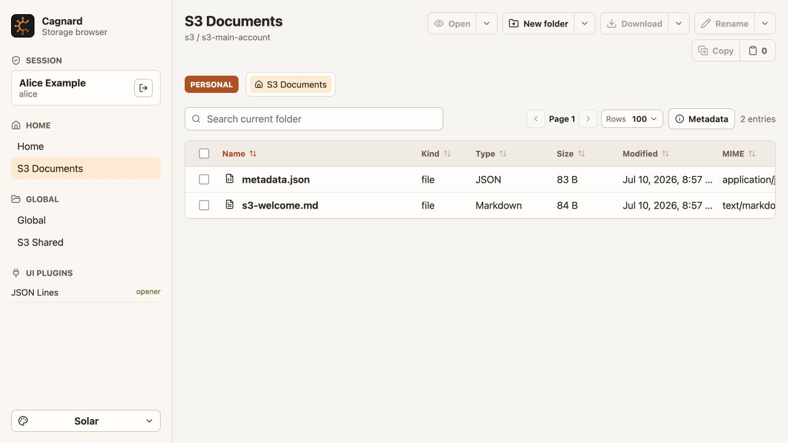

# Cagnard Documentation

  

Cagnard is a self-hosted, provider-neutral storage browser. Start with a runnable deployment, then follow the path that matches your goal. These pages describe the code in this checkout; released deployments need documentation and configuration from their matching release tag.

## Start Here

| Goal | Guide |
| --- | --- |
| Try Cagnard with Docker | [Docker quick start](getting-started/docker.md) |
| Install Cagnard on Kubernetes | [Helm quick start](getting-started/helm.md) |
| Work on Cagnard from source | [Development setup](getting-started/development.md) |
| Understand users, roles, and storage access | [Access guide and model diagram](guides/users-and-storage-access.md) |
| Add SSO while keeping static login | [OIDC setup](guides/oidc.md) → [local Keycloak exercise](../examples/run/oidc-keycloak/README.md) |
| Upgrade an existing auth configuration | [Auth v2 migration](guides/migrating-auth.md) |

## Use Cagnard

- [Browse, copy, move, and manage files](guides/browsing-and-transfers.md)
- [Open files, search content, and use viewers](guides/file-viewers.md)
- [Explore relational data, Iceberg, and NetCDF](guides/structured-data.md)
- [Configure users and personal/global storage](guides/users-and-storage-access.md)
- [Connect S3-compatible storage and MinIO](guides/s3-and-minio.md)
- [Choose and configure appearance](guides/appearance.md)

## Operate Cagnard

- [Configuration](operations/configuration.md)
- [OIDC setup and troubleshooting](guides/oidc.md)
- [Auth migration and rollback](guides/migrating-auth.md)
- [Containers, Kubernetes, and production deployment](operations/deployment.md)
- [Authentication, secrets, and security boundaries](operations/security.md)
- [Release artifacts and upgrades](operations/releases.md)

## Understand And Extend Cagnard

- [Architecture overview](architecture/overview.md)
- [Authentication and OIDC sequence](architecture/authentication.md)
- [Storage providers and capabilities](architecture/storage-plugins.md)
- [First-party file openers](architecture/file-openers.md)
- [Structured-data runtime and limits](architecture/structured-data-limits.md)
- [Background task engine](architecture/tasks.md)
- [Configuration reference](reference/configuration.md)
- [Task API reference](reference/task-api.md)
- [Provider capability reference](reference/provider-capabilities.md)

## Contribute

- [Testing and validation](contributing/testing.md)
- [Adding a first-party file opener](contributing/file-openers.md)
- [Documentation maintenance](contributing/documentation.md)

Engineering requirements live in [`openspec/specs`](../openspec/specs), with pending changes under [`openspec/changes`](../openspec/changes). Use the guides here for the current user and operator workflow.

## Diagrams

Each diagram sits beside the instructions or explanation it supports:

- [How users, groups, roles, bindings, and roots connect](guides/users-and-storage-access.md#how-the-models-fit-together)
- [How a storage request is authorized](reference/authorization.md#how-a-request-is-decided)
- [How a root resolves through an account and storage key](reference/storage-access.md#storage-relationships)
- [OIDC browser and backend round trip](architecture/authentication.md#oidc-round-trip)
- [Public origin, proxy, backend, storage, and IdP](operations/deployment.md#request-path-and-public-origin)
- [Copy-then-delete behavior of a move](guides/browsing-and-transfers.md#what-a-move-does)
- [Task lifecycle](architecture/tasks.md#lifecycle)
- [Where structured data is processed](architecture/structured-data-limits.md#where-data-is-processed)

## Authentication model map

Start with [Users and storage access](guides/users-and-storage-access.md) or [the full static/SSO config](../config/cagnard.oidc.example.conf). Follow [OIDC setup](guides/oidc.md) for a new provider and [migration](guides/migrating-auth.md) for an existing installation.

| Model | Reference |
| --- | --- |
| Login providers, static users, external mappings, development | [Authentication](reference/authentication.md) |
| Canonical principal, sessions, login transactions, execution evidence | [Identities and sessions](reference/identity-and-sessions.md) |
| Groups, roles, subjects, root-scoped bindings, effective actions | [Authorization](reference/authorization.md) |
| Storage providers, accounts, roots, storage keys, resolved access | [Storage access](reference/storage-access.md) |
| Request flow and package responsibilities | [Architecture](architecture/authentication.md) |
