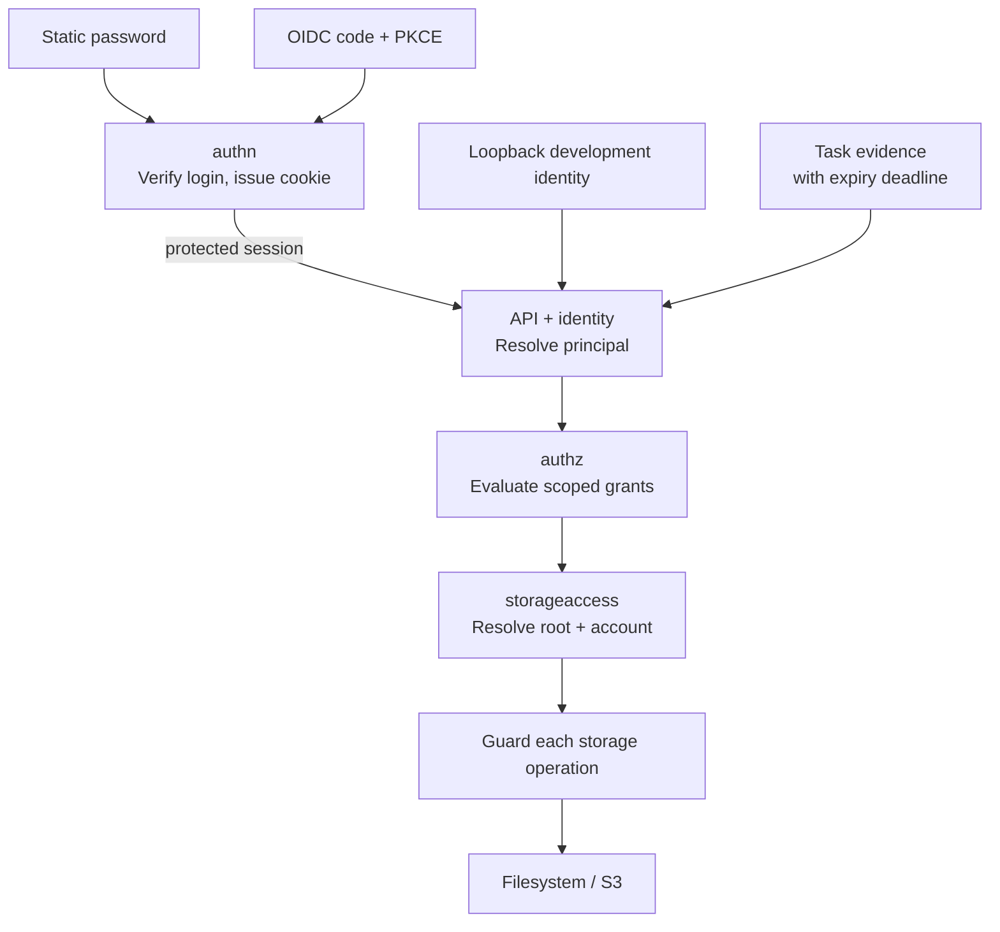
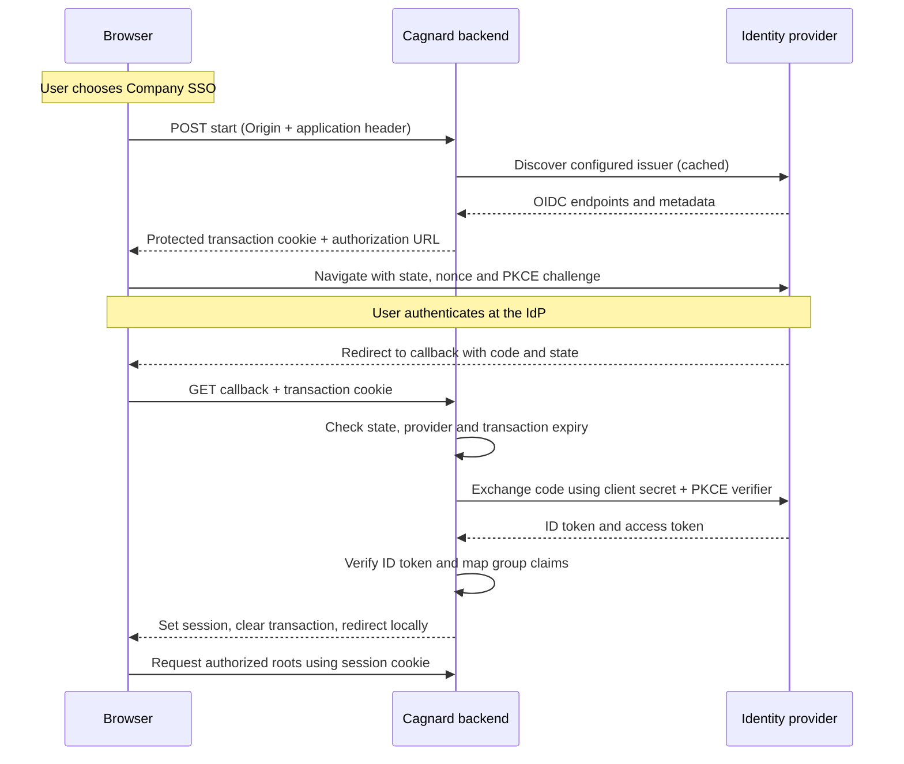

# Authentication and authorization architecture

Cagnard uses one request pipeline for static login, OIDC, explicit local development, and task execution. Model definitions are split into [providers](../reference/authentication.md), [identity/session evidence](../reference/identity-and-sessions.md), [policy](../reference/authorization.md), and [storage access](../reference/storage-access.md).

## Package responsibilities

| Package | Owns | Must not own |
| --- | --- | --- |
| `identity` | Canonical IDs, principal fields, storage-key syntax, action catalog | HTTP, credentials, policy evaluation |
| `authn` | Provider discovery, password verification, OIDC verification/transactions, protected sessions, current evidence resolution | Storage grants |
| `authz` | Declared roles and additive subject/root binding evaluation | Passwords, cookies, filesystem paths |
| `storageaccess` | Target interpolation, account ceilings, API-facing guarded provider adapter | Login flows or inferred user roles |
| `api` | Public/protected route boundary, origin checks, HTTP errors, bounded task dispatch | A second policy evaluator |
| `storage` | Confined filesystem/S3 I/O and technical capabilities | Browser identity or role semantics |

The [configuration loader](../reference/configuration.md) validates cross-model references at startup. No legacy evaluator runs alongside v2.

## Browser authentication flow

Static login posts a provider ID, username, and password to `/api/auth/login`. The enabled configured user is verified with the existing PBKDF2 format. The backend creates canonical identity evidence, protects it with the session codec, and returns the ordinary session response.

OIDC starts with an origin-checked POST to `/api/auth/providers/{id}/start`. The backend discovers the configured issuer, creates a five-minute protected transaction, and returns an authorization URL. The browser navigates to the IdP. The callback verifies transaction state/provider/expiry, exchanges the single-use code with PKCE and client authentication, verifies the ID token and nonce, extracts bounded mapping evidence, issues the common cookie, clears the transaction, and redirects locally. A failed callback redirects to a fixed safe error marker, which the UI removes from browser history.

Discovery/exchange/JWKS responses are bounded to 1 MiB and requests to eight seconds. Failed discovery is retried after a short backoff; provider tokens never enter frontend state. The implementation pins `coreos/go-oidc`, `oauth2`, and `gorilla/securecookie` in the Go module.

### OIDC round trip

The browser receives an authorization code and Cagnard cookie. Provider access tokens and ID tokens stay in the backend.

Failure never creates a partial identity. The callback clears the transaction and returns a safe error; see [OIDC troubleshooting](../guides/oidc.md#troubleshooting). Static login reaches the same session and authorization path after password verification.

## Request boundary

Only health, appearance, provider discovery, login/logout, OIDC start, and OIDC callback routes are public. New API routes inherit authentication unless deliberately added to the allowlist. Structured-data configuration is protected. Arbitrary bearer credentials are rejected, including old Cagnard bearer sessions.

Every browser mutation requires the exact configured `Origin` and `X-Cagnard-Request: 1`, including login and logout. The callback is a GET protected by its transaction. There is no permissive CORS response and no trust in client-supplied forwarding headers. Cookies are HttpOnly and production cookies use the `__Host-` prefix.

The middleware resolves authentication before routing, stores verified evidence in context, and attaches its absolute deadline. Public handlers still perform their own flow-specific checks. Each protected operation obtains a root through the shared access service with explicit required actions; guarded provider methods recheck additional physical operations such as mkdir or source deletion.

## Tasks and streams

Task owners use canonical principal IDs. Task evidence excludes request cookies, Authorization headers, and OIDC tokens. A new operation or conflict continuation resolves the evidence and current grants again. Streams, watches, recursive deletion, and copy/write operations use bounded contexts. See [task lifetime and continuation](tasks.md#authentication-and-continuation) for partial effects and limitations.

## Error and audit contract

Authentication failures are 401; denied actions on accessible roots are 403; inaccessible roots and another principal's tasks are 404. A 403 leaves the UI signed in. Callback and provider errors reveal no token, secret, or complete claim set. Audit events identify the canonical principal, provider where relevant, root/tunnel, action, and outcome; mutation authorization events are not claims that an operation completed.

## Verification

Backend tests cover identity separation, current static state, session tampering/expiry/rotation/size, default-deny policy, origin checks, read-route bypasses, action checks, read-only ceilings, task isolation, and fresh conflict continuation. A local OIDC fixture exercises exchange, invalid tokens, nonce/state/transaction expiry, PKCE, code replay, key rotation, and provider outage. The [Keycloak exercise](../../examples/run/oidc-keycloak/README.md) supports live interoperability checks; protocol fixtures do not replace testing a deployment's actual IdP configuration.
