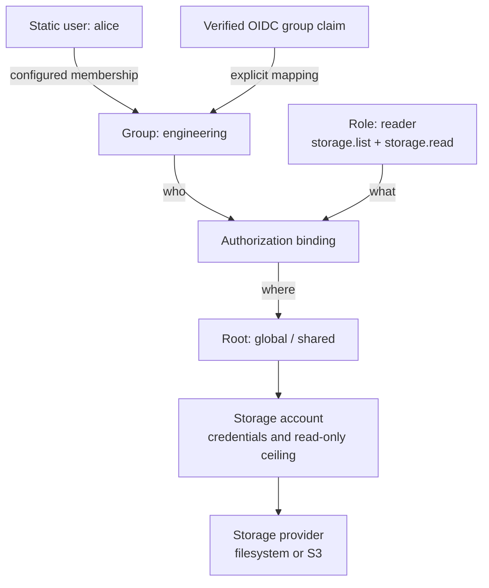

# Users and storage access

Configure login, application groups, scoped roles, and storage accounts independently. A valid login with no grants is a supported state: the user remains signed in and sees that access has not been assigned.

The full [static and OIDC example](../../config/cagnard.oidc.example.conf) shows local recovery access, SSO mappings, personal homes, shared documents, read-only accounts, and an explicit all-authenticated handbook.

## How the models fit together

A **group** describes an audience, a **role** lists actions, and a **binding** grants those actions on selected roots. The same application group can contain people who use different login methods.

For example, a reader binding on `global/shared` lets both Alice and mapped SSO users browse and read that root. It grants nothing on another root. The storage account can reduce access further, but it cannot grant an action that the binding omitted.

## Configure access in order

1. Declare [authentication providers and static users](../reference/authentication.md). Keep provider IDs and subjects stable.
2. Declare [application groups](../reference/authorization.md#group-model). Static users join them directly; OIDC providers map exact trusted claim values to them.
3. Declare [roles](../reference/authorization.md#role-model) as explicit action lists. Names such as `reader` and `manager` have only the privileges you write down.
4. Configure [storage providers, accounts, and roots](../reference/storage-access.md). Give the backend only necessary storage credentials and mounts.
5. Add [bindings](../reference/authorization.md#binding-model) connecting groups or direct identities to roles on named roots. Missing bindings deny access.
6. Test each intended audience, an unassigned user, and denied mutations. See the [permission matrix](../reference/authorization.md#effective-permissions-and-operation-composition).

## Personal and global areas

Personal and global are separate root namespaces, not permission levels. A personal home path can use `/srv/homes/{principal.storageKey}`. The `{principal.storageKey}` template makes the target depend on the signed-in identity. A fixed path or prefix is shared by everyone granted that root, even under `personalStorage`; the personal/global label alone does not isolate data. Use a global root for deliberately shared data and a templated root for individual homes. See [storage targeting](../reference/storage-access.md#storage-key-model).

## Check the result

| What the user sees | What to inspect |
| --- | --- |
| Login fails | Provider/user enablement and password or IdP configuration. |
| “You’re signed in” with no storage | Group mapping, bindings, and enabled storage accounts. |
| Root is visible but an action is unavailable | That root’s role actions, account read-only flag, and provider capability. |
| Home is empty or unavailable after migration | Explicit storage key, target template, directory existence, and OS permissions. |

Change configuration, restart the backend, and retest with the intended user. See [session freshness](../reference/identity-and-sessions.md#freshness-and-invalidation) for changes that require a new login.

## Keep static login alongside SSO

Put both provider objects in `auth.providers`. The login screen offers a local form and SSO button. Grant the recovery identity explicitly; there is no superuser switch. SSO users need no local account entry and never inherit a static identity from a matching name or email.

Follow the [OIDC setup guide](oidc.md) and read the [session freshness and logout contract](../reference/identity-and-sessions.md). For an existing installation, first use the [migration guide](migrating-auth.md) to preserve grants and homes deliberately.
