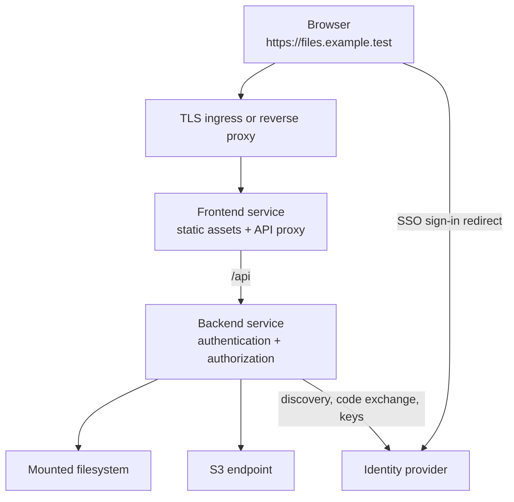

# Deployment

Cagnard is delivered as two images and one Helm chart:

- `ghcr.io/k3rnl/cagnard-backend:<release>`
- `ghcr.io/k3rnl/cagnard-frontend:<release>`
- `oci://ghcr.io/k3rnl/charts/cagnard --version <release without v>`

Use matching frontend and backend release tags. The frontend serves static assets and proxies `/api` to the backend; only the frontend normally needs public ingress.

## Request path and public origin

Use one browser origin for the frontend and `/api`. Internal service addresses are not the value of `auth.publicUrl`.



Set `auth.publicUrl = "https://files.example.test"`, keep Secure cookies enabled, and register the [OIDC callback](../guides/oidc.md) under that same origin. Preserve the browser’s `Origin` header. If ingress routes `/api` directly to the backend, it replaces the frontend API-proxy hop; the public origin remains the same.

An identity provider's private CA must be trusted inside the backend container. The [OIDC certificate guide](../guides/oidc.md#self-signed-certificates-and-private-cas) includes Helm and Compose mounts and the explicit per-provider verification bypass.

## Containers

The backend requires a HOCON file and access to every configured provider endpoint or filesystem path. The frontend requires `CAGNARD_API_UPSTREAM` when its API upstream is not the default backend service name.

Use a runnable example as a deployment rehearsal:

```bash
cd examples/run/local-and-s3-static
cp .env.example .env
docker compose up -d
docker compose ps
```

The examples pin v0.12.1 application images and auth v2 configuration. Add `docker-compose.build.yaml` when testing local source changes. For other releases, use the configuration and examples from the same tag. See [migration](../guides/migrating-auth.md) before combining a new binary with existing configuration.

## Kubernetes And Helm

The chart creates separate frontend and backend Deployments and Services. Backend configuration can come from exactly one source:

- `backend.config.inline`
- `backend.config.existingConfigMap`
- `backend.config.existingSecret`
- `backend.config.existingVolume`

Production deployments usually mount secret-bearing HOCON from an existing Secret or external-secret-managed volume. Keep the chart version and both image tags pinned to a tested release.

The chart can route `/api` to the backend through one Ingress when `ingress.routeApiToBackend` is enabled. Terminate TLS at the ingress and set `auth.session.secureCookies = true`.

## Filesystem Storage

Container filesystems are ephemeral. If a filesystem provider stores real data, mount a persistent volume at the exact path used by each root. Ensure the backend process can read and, for writable roots, create content there. Multiple backend replicas must see the same filesystem and still do not share task memory.

S3 roots do not need a data volume, but their endpoint and credentials must be reachable from every backend pod.

## Health And Rollout

`GET /api/health` confirms that the HTTP process is running and returns safe aggregate counts. It does not test storage reachability or OIDC discovery. The Helm chart uses it for liveness and readiness probes.

After rollout, verify:

```bash
kubectl rollout status deployment/cagnard-backend
kubectl rollout status deployment/cagnard-frontend
kubectl port-forward service/cagnard-frontend 5173:80
```

Then test authentication, visible roots, one listing, and expected read-only behavior.

## Streaming Proxy Settings

Downloads and uploads are long-lived streaming requests. Configure ingress and reverse-proxy read, send, and request-body timeouts for the largest expected operation. Disable response buffering for `/api/tasks/*/content`; disable request buffering for `/api/tasks/*/uploads/*` when the proxy would otherwise store a complete upload before forwarding it.

Do not impose a proxy body-size limit below the intended maximum file size. Preserve byte-range headers and avoid middleware that transforms ZIP or binary responses. A stream failure after headers is reported in the task queue and server logs because the response can no longer become a JSON error.

## Scaling Limits

The request API is stateless, but active tasks are held in backend memory. A backend restart loses active task state, and replicas do not share the queue, authenticated download URLs, or upload manifests. Until a durable task store is introduced, use one backend replica. If multiple replicas are unavoidable, configure session affinity so task creation, polling, and streaming reach the same process. Provider data already written remains in the provider.

## Production Checklist

- Replace all demo verifier material, access keys, and session protection keys.
- Use TLS and secure cookies.
- Mount durable filesystem roots or use external object storage.
- Apply CPU/memory requests and limits based on transfer and opener workloads.
- Set streaming timeouts and buffering rules for large upload/download requests.
- Restrict backend network access and filesystem mounts to required providers.
- Configure log collection without secret-bearing configuration dumps.
- Validate backup, object versioning, retention, and deletion behavior at the provider layer.
- Test upgrades with the exact chart, frontend image, backend image, and configuration combination.

See [Security](security.md) and [Releases and upgrades](releases.md).
