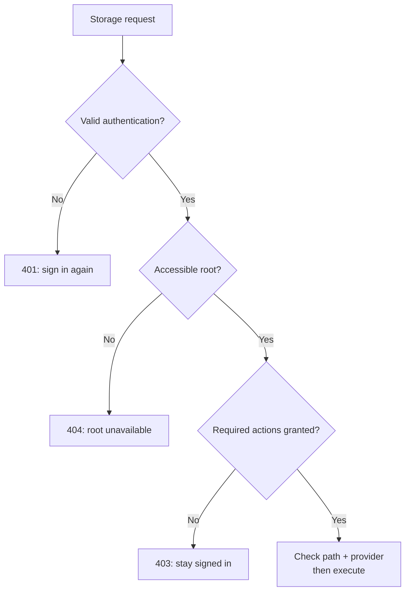

# Authorization

Authorization grants a [principal](identity-and-sessions.md#principal-model) actions on named [storage roots](storage-access.md#root-model). Authentication alone grants nothing. There is one additive evaluator, used by navigation, content APIs, mutations, and background execution.

See the [complete configuration](../../config/cagnard.oidc.example.conf), [migration examples](../guides/migrating-auth.md), and [runtime architecture](../architecture/authentication.md).

## Group model

The `groups`, `roles`, and `bindings` fragments on this page all belong inside `authorization { ... }`. They are not top-level keys.

```hocon
groups = [
  { id = engineering, label = Engineering },
  { id = auditors, label = Auditors }
]
```

A group is a declared application audience with a unique non-empty `id` and optional display `label`. It grants no permission by itself. Static users reference its ID; OIDC providers map trusted external values to it. Groups are flat: no nesting, implicit creation, or role inheritance.

## Role model

```hocon
roles = [
  { id = reader, actions = ["storage.list", "storage.read"] },
  { id = editor, actions = ["storage.list", "storage.read", "storage.write", "storage.mkdir", "storage.rename"] }
]
```

A role is a named set of explicit known action IDs. IDs are unique; action arrays must be non-empty. No role name, including `admin`, has built-in privileges. Roles are never attached globally to a user. There are no wildcard actions or deny rules in v2.

| Action | Permitted operations |
| --- | --- |
| `storage.list` | List a root's entries and browse directories. |
| `storage.read` | Stat and content, byte ranges, previews, content search, archive members, Iceberg references, downloads and watches. |
| `storage.write` | Upload/create file content, save, and explicitly approved file overwrites. |
| `storage.mkdir` | Create directories, including directories created while uploading or copying. |
| `storage.rename` | Rename an existing entry inside its root. Rename rejects an existing target. |
| `storage.delete` | Delete entries or recursive trees, and remove a move source. |

An editor can overwrite content and rename it; omitting `delete` does not make the role non-destructive. Existing confirmation and conflict choices still apply and do not grant permissions.

## Subject model

Each binding subject selects exactly one audience:

| Shape | Matches |
| --- | --- |
| `{ group = engineering }` | Principals with this declared application group. |
| `{ providerId = local, subject = alice }` | One provider-qualified identity. Static subjects must exist in that provider; OIDC subjects may be provisioned at the IdP. |
| `{ authenticated = true }` | Every successfully authenticated principal. This is explicit, including users with no mapped groups. |

Display names and email addresses are not identity references. Direct subjects are scoped to the configured provider and its issuer. Changing that provider's issuer invalidates its existing sessions and changes canonical IDs.

## Binding model

```hocon
bindings = [{
  subjects = [{ group = engineering }, { providerId = local, subject = recovery }]
  roles = [editor]
  roots = [{ tunnel = global, rootId = shared }]
}]
```

All three arrays must be non-empty. Subjects within a binding are alternatives. Every matching subject gets the union of the listed roles on every listed root. Multiple bindings add grants. Each role/group/root reference is validated at startup.

A root reference is the pair `{ tunnel, rootId }`, where tunnel is `personal` or `global`. Equal root IDs in different tunnels do not share permissions. A home root using `{principal.storageKey}` resolves separately for each principal. A fixed path remains shared even in the personal tunnel; see [root targeting](storage-access.md#root-model).

## How a request is decided

The following decision applies after a request passes the browser-origin check. An accessible root needs effective grants and an enabled account. No matching grant means no access; a successful login does not bypass any step.



The final step can still fail because of a provider limitation, missing path, or storage error. An authorized request is not a guarantee of successful I/O.

## Effective permissions and operation composition

Root actions are policy grants reduced by account enablement and read-only status; the HTTP demo provider also removes mutation actions. Entry capabilities and provider checks determine whether a granted operation is technically supported. An account or provider capability never adds a policy grant. Roots with no effective actions are absent from navigation and return 404. A known accessible root with a denied action returns 403. Missing or invalid authentication returns 401.

| Operation | Required source actions | Required destination actions |
| --- | --- | --- |
| Copy file | `storage.read` | `storage.write` |
| Move file | `storage.read`, `storage.delete` | `storage.write` |
| Copy or move a directory | Same source actions as above | `storage.write`, `storage.mkdir` |
| Create a missing parent during upload/copy | As above | Also `storage.mkdir` |
| Replace an existing directory tree | As above | Also `storage.delete` |

Move checks source delete permission before any destination effect. Ordinary file overwrite uses `storage.write`. Source/destination inspection is part of the authorized operation, not a separate public listing grant. A write-only upload role does not also need `storage.read`.

The API-facing provider adapter rechecks current grants and expiry before physical operations. Recursive operations and streams carry bounded contexts. Root `actions` drive UI controls; the backend remains authoritative. A reader cannot gain write access by invoking an alternate content, archive, transfer, task, or Iceberg route.
