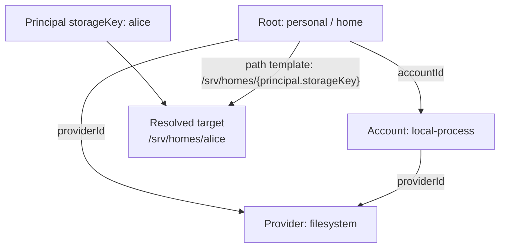

# Storage access models

Storage configuration describes **where data lives and how the backend reaches it**. [Authentication providers](authentication.md) identify users; [authorization bindings](authorization.md) grant actions. Storage provider IDs and login provider IDs live in separate namespaces.

The [configuration reference](configuration.md#providers) lists storage-specific settings. The [full example](../../config/cagnard.oidc.example.conf) connects all models.

## Storage relationships

A **provider** chooses the implementation, an **account** supplies the backend’s access and restrictions, and a **root** selects the data shown to users. A binding names a root; the browser does not choose account credentials or a host path.



For S3, the same key is substituted into `settings.prefix`; the root also supplies a bucket. Several roots can use one account. Each root/account pair must reference the same provider.

## Storage provider model

A provider has a unique `id`, implementation `type` (`filesystem` or `s3`), presentation `displayName`, family, and settings. It supplies operations and reports technical capabilities. Capability support does not grant users access. The HTTP provider is reserved for the compiled, read-only browser demo.

## Account model

An account has a unique `id`, `providerId`, `displayName`, `enabled`, `readOnly`, `authMode`, and implementation settings. It holds backend storage credentials, not user credentials. A root must reference an account belonging to its provider.

Disabled accounts expose no roots. `readOnly = true` removes all mutation actions even if a binding grants them. Use separate accounts when shared data needs a read-only ceiling. S3 supports static, profile, and default-chain credentials; see [S3 and MinIO](../guides/s3-and-minio.md). Scope filesystem mounts and provider IAM independently of application policy.

## Root model

`personalStorage[]` and `globalStorage[]` contain `id`, optional `label`, `providerId`, `accountId`, and a target (`path` for filesystems, `settings.bucket`/`settings.prefix` for S3). The stable identity is `(tunnel, id)`. Labels are presentation only.

The tunnel is a navigation namespace, not an isolation mechanism. A fixed filesystem path or S3 prefix is shared by every identity granted that root. Use `{principal.storageKey}` where a per-identity target is intended.

Roots declare no users, roles, or groups. All grants live in [bindings](authorization.md#binding-model). No binding means no access, including formerly unrestricted roots. An authenticated user with no roots remains signed in and sees an explanatory empty state.

The only identity substitution is `{principal.storageKey}`, supported consistently in filesystem paths and S3 prefixes. Arbitrary claims and `{user.id}` are rejected. Relative filesystem paths resolve against the configuration file's directory.

## Storage key model

A key is a single segment, 1–128 ASCII characters, beginning with a letter or digit and containing only letters, digits, `.`, `_`, and `-`. It cannot be a path. Explicit assignments must be globally unique across configured static users and OIDC overrides. The `p-` prefix is reserved for derived keys.

The default is a hash-derived segment from the canonical identity. Target resolution does not provision a home or move its data: prepare filesystem directories and OS permissions before use. S3 prefixes may initially be empty. For a predictable provisioned directory, configure an explicit key. To preserve `/srv/homes/alice` during migration:

```hocon
# Inside the static provider's alice user:
storageKey = alice
# Inside the personal root:
path = "/srv/homes/{principal.storageKey}"
# Equivalent S3 target:
# settings { bucket = team-data, prefix = "homes/{principal.storageKey}" }
```

OIDC identities do not inherit a same-named static home. To move ownership deliberately, remove the old explicit assignment, then configure the OIDC provider with `storageKeys = [{ subject = "verified-idp-subject", storageKey = alice }]`. Review filesystem permissions and bindings and restart with the coordinated configuration. There is no automatic data move, email linking, or duplicate-key sharing exception. Use a separately named shared root and explicit bindings for shared data.

Filesystem operations reject traversal and symlinks at the configured root and within its descendants. Administrators must control the mount and root-parent hierarchy; path checks do not replace OS/container isolation against concurrent hostile filesystem changes. See [security](../operations/security.md#filesystem-isolation).

## Resolved access model

For a request, the access service joins principal, root, account, provider, and policy into a resolved target plus effective `actions`. The API exposes root ID, label, tunnel, provider/account references, capability statuses, `readOnly`, and `actions`; it never sends filesystem targets or backend credentials to the browser.

Background tasks use the same resolver and [bounded execution evidence](identity-and-sessions.md#logout-and-execution-context). Root renames, provider/issuer changes, key reassignment, and policy edits are deployment changes; follow the [migration and rollback procedure](../guides/migrating-auth.md#deploy-and-roll-back).
