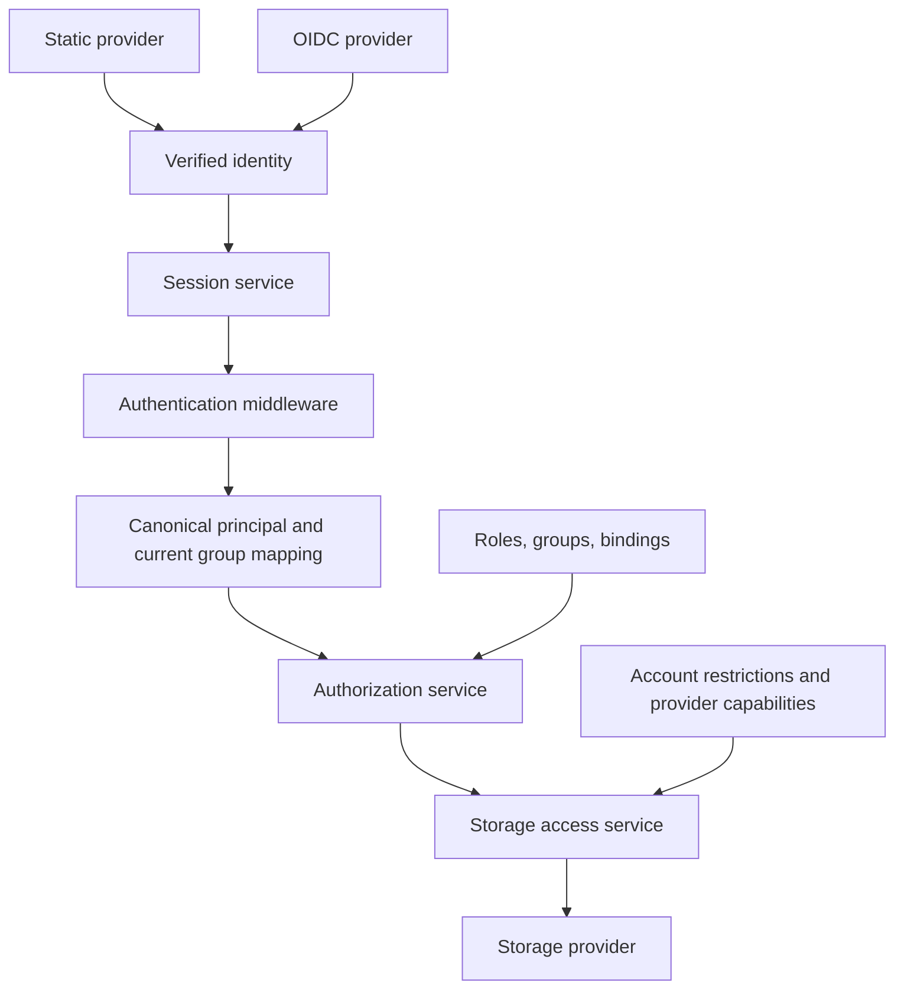

## Context

Static authentication currently verifies configured PBKDF2 password material and issues an HMAC-signed cookie. `UserResolver` selects mutually exclusive modes, discards provider-qualified identity before downstream use, and includes an external JWT decoder that neither verifies tokens nor propagates parsing errors correctly. `AccessService` uses undeclared user/role/group strings and permits roots without selectors. Root enforcement is repeated in request and transfer helpers.

The Go backend and React frontend must keep working without a required application database. Configuration is loaded at startup, so configuration changes take effect after restart. Storage accounts remain backend credentials, independent of end-user identity. This design is implemented by this change; verification status is recorded in tasks.md.

## Goals / Non-Goals

**Goals:**

- Preserve static login; allow static and multiple OIDC providers to coexist.
- Authenticate once per request into one canonical principal and enforce permissions through one authorization service.
- Give groups, roles, and root bindings explicit, distinct meanings with startup validation.
- Support different read/write/delete permissions for different users on the same root.
- Keep browser credentials HttpOnly and provider tokens out of frontend state.
- Make identity migration, external membership freshness, logout, and background task expiry explicit.
- Deliver the foundation before introducing the real OIDC provider.

**Non-Goals:**

- User/group administration UI, self-registration, password recovery, nested groups, role inheritance, policy expressions, or per-file ACLs.
- Automatic linking of static and OIDC accounts by username or email.
- Delegating an end-user OIDC token to S3 or impersonating a Unix user.
- Public API bearer authentication, service accounts, refresh tokens, offline access, or identity-provider-wide logout in this first iteration.
- A required session/policy database, immediate external revocation, or guaranteed cancellation on local logout.

## Decisions

### 1. Separate authentication, identity mapping, authorization, and storage execution



- `internal/authn`: provider registry, static/OIDC implementations, verified identity, session codec, browser transaction handling, and middleware. Provider-specific request types stay within their adapters; metadata and successful identity results share a small contract.
- `internal/identity`: pure principal identifiers and validated attributes; no HTTP or storage-provider dependency. Membership mapping uses validated external evidence plus current configuration.
- `internal/authz`: compile declared roles/groups/bindings and evaluate `Check(principal, action, rootRef)` and `Permissions(principal, rootRef)`. Return typed decisions; no credential access or provider calls.
- Storage access service: resolve authorized resources, intersect permission decisions with account restrictions and provider capabilities, and execute operations through scoped helpers. API handlers and task runners use this same service.
- Storage providers: enforce target confinement and account restrictions defensively, but do not interpret login providers, role names, or group claims.

Protected route groups require authentication middleware by construction. Only an explicit public allowlist contains health/appearance, provider discovery, login entry points, and OIDC callback routes. Remove raw `RequestIdentity` plumbing from normal storage execution. Navigation and UI permissions use the same evaluator as mutations.

Alternative: add OIDC branches to `UserResolver` and extend `AccessService`. Rejected because it preserves identity loss and duplicated enforcement.

### 2. Preserve stable identity; separate it from a storage directory name

The canonical principal contains an opaque ID derived from an unambiguous versioned tuple, `providerId`, `issuer` for OIDC, `subject`, display name, declared application group IDs, and authentication expiry/context. Static subject is the configured immutable user ID. OIDC subject is validated `sub`; email and preferred username are display attributes, not identity keys. The issuer participates in OIDC identity so repointing a provider ID cannot inherit old access.

Bindings use structured identity references such as `{ providerId = local, subject = alice }`; the compiler resolves an OIDC provider's configured issuer. Opaque IDs are used for task owners, browser synchronization channels, and internal identity comparisons. Neither providers nor delimiters may cause identity collisions. There is no global `isAdmin` property or unscoped role list on the principal.

Personal storage uses a separate `storageKey`: one validated path segment. By default it is derived from the opaque principal ID; static migration explicitly sets `storageKey = alice` to retain an existing home. Administrator-controlled overrides can assign an existing home to a particular external identity; equal email addresses never do so automatically. Duplicate explicit storage keys across identities always fail validation. Deliberate sharing uses separately configured shared roots and bindings. Filesystem targets and S3 prefixes use `{principal.storageKey}` consistently. Remove arbitrary claim interpolation; validate the resulting target against the configured base and never permit separators, traversal, empty segments, or unresolved placeholders in the key.

Alternative: keep `sub` or username as the universal user ID and path component. Rejected because issuers can reuse subjects and names can change or contain path syntax.

### 3. Declare groups, roles, and bindings separately

- **Group**: a named set of people, such as `engineering`. Declare application groups with IDs and optional labels. Static users explicitly reference declared group IDs. OIDC claims are mapped to these same IDs using provider-scoped exact-value rules.
- **Role**: a named set of allowed actions, such as `reader` or `editor`. Every role is declared. No magic `admin`, implied privileges, wildcards, or inheritance.
- **Binding**: grants one or more roles to one or more groups/principals on explicit `{ tunnel, rootId }` resources. Multiple matching grants are additive. No match denies access. An optional explicit `authenticated = true` subject supports deliberate access for every authenticated user; an empty selector never means everyone.

Role assignment belongs to bindings, not `users[].roles`. This permits Alice to be an editor on `global/shared` and a reader on `global/archive`. A provider's group or role named `admin` grants nothing unless an administrator maps it and binds permissions.

Initial action catalog:

| Action | Operations |
| --- | --- |
| `storage.list` | Root navigation and directory listing |
| `storage.read` | Stat, file content, download, previews, archive reads, search, watch, structured-data and Iceberg reads |
| `storage.write` | Create/update file content and explicitly approved replacement |
| `storage.mkdir` | Create directories |
| `storage.rename` | Rename within a root |
| `storage.delete` | Delete entries and source removal during moves |

Example role definitions: reader = list/read; editor = list/read/write/mkdir/rename; manager = editor actions plus delete. These names are example configuration, not built-in powers. Editor includes overwrite and rename, so it is not a promise of non-destructive access. An operator can define a narrower uploader role.

Copy requires source read and destination write, plus destination mkdir when creating directories. Move adds source delete. Same-root copy/move obey the same composition; optimized provider calls must not bypass it. Rename uses rename permission and rejects an existing destination. Explicit replacement uses the transfer workflow and its write/delete checks. A read-only account removes write/mkdir/rename/delete regardless of role. Provider capabilities remain another restriction, never a source of permission.

Unknown IDs/actions, duplicate declarations, empty bindings, mismatched provider/account references, and invalid resource scopes fail startup. Unknown external claim values are unmapped and grant nothing. A missing optional groups claim means no groups; a present claim with an invalid type fails authentication. Nested claim paths use a defined syntax, JSON Pointer, rather than ad hoc dotted-key guessing.

Alternative: leave groups/roles as interchangeable labels and add declarations only for documentation. Rejected because it cannot express scoped action permissions or catch misspelled grants.

### 4. Use an explicit, versioned configuration model

The original design walkthrough is [examples/cagnard.conf](examples/cagnard.conf), covering static and OIDC users, declared groups/roles, grants, filesystem roots, an S3 archive, and externalized credentials. The maintained runnable configuration is `config/cagnard.oidc.example.conf` in the repository root; use that implementation-aligned version for deployment.

Illustrative target schema (not supported by the current binary):

```hocon
auth {
  version = 2
  publicUrl = "https://files.example.test"
  session {
    key = ${CAGNARD_SESSION_KEY}
    ttlSeconds = 3600
    secureCookies = true
  }
  providers = [
    {
      id = local
      type = static
      label = "Cagnard account"
      enabled = true
      users = [
        {
          id = alice
          displayName = Alice
          enabled = true
          storageKey = alice
          groups = [engineering]
          credential.verifier = ${ALICE_PASSWORD_VERIFIER}
        }
      ]
    },
    {
      id = company
      type = oidc
      label = "Company SSO"
      enabled = true
      issuer = "https://sso.example.test/realms/company"
      clientId = cagnard
      clientSecret = ${CAGNARD_OIDC_CLIENT_SECRET}
      scopes = [openid, profile, email]
      groupMappings = [
        { claim = "/groups", value = "/engineering", group = engineering }
      ]
    }
  ]
}

authorization {
  groups = [{ id = engineering, label = Engineering }]
  roles = [
    { id = reader, actions = ["storage.list", "storage.read"] },
    {
      id = editor
      actions = ["storage.list", "storage.read", "storage.write", "storage.mkdir", "storage.rename"]
    }
  ]
  bindings = [
    {
      subjects = [{ group = engineering }]
      roles = [editor]
      roots = [{ tunnel = global, rootId = shared }]
    },
    {
      subjects = [{ providerId = local, subject = alice }]
      roles = [reader]
      roots = [{ tunnel = global, rootId = archive }]
    }
  ]
}
```

Roots keep target/provider/account declarations and lose access-selector fields. For a personal root binding, the target is derived separately for each authorized principal using its storage key. Static and mapped OIDC members of `engineering` receive exactly the same permissions from the first binding above. External users need no local user declaration.

Development identity is an explicit, separately named `auth.development` option, mutually exclusive with production providers. It never decodes unsigned bearer tokens. Missing auth configuration fails startup. Explicit local-loopback development configuration may relax HTTPS cookie requirements for local examples; production configuration uses HTTPS and the configured public origin.

### 5. Share one application session across login providers

Use a versioned authenticated-encryption cookie supported by a reviewed library, with a random externally supplied key, HttpOnly, SameSite=Lax, Path=/, and Secure in production. Use a host-only cookie and the `__Host-` prefix when Secure is enabled. The default absolute lifetime is one hour, configurable; no sliding or silent renewal in this iteration. A format change intentionally invalidates old sessions. Use separate cryptographic purposes for application sessions, login transactions, and signed pagination references, through separately configured or context-derived keys. Migrate the existing pagination dependency on `auth.session.signingSecret`; removing that field must never cause an empty-key fallback.

- Static session: identity reference and a server-derived credential revision. Resolve enabled user, current groups, and credential revision from runtime config on every request. Disabling/removing the user or changing its verifier invalidates existing sessions after restart. Do not embed verifier material.
- OIDC session: validated identity plus a minimal, bounded snapshot of the configured claim fields needed for membership mapping. Do not store access/refresh/ID tokens or all arbitrary claims. Reapply current group mappings and role bindings to the snapshot on every request. Changing issuer/client/required claim paths invalidates the incompatible session; changing mapping values or role bindings uses current configuration.
- Reject sessions that exceed a conservative encoded-cookie limit, e.g. 3,500 bytes; never silently truncate membership data. Report an actionable safe sign-in error so operators can narrow claims.
- Provider enabled state, session version, integrity, expiry, identity shape, and provider configuration binding are checked on every request. Authentication failure never becomes an empty principal or development fallback.

OIDC membership changes at the identity provider are visible at the next authentication, bounded by the application session lifetime. ID-token validity is checked at login; application-session expiry is the earlier of ID-token expiry and the configured application lifetime. No shared session database is required. Network/JWKS caches are disposable performance state.

The browser uses cookies only. Remove the overloaded Cagnard-session/external-bearer behavior; unsupported Authorization credentials are rejected, not interpreted as identity. Future resource-server/API-token support requires a separate audience and validation contract.

Local logout clears the cookie and browser data; copied cookies remain replayable until expiry or configured invalidation. It does not log the user out of the identity provider or revoke already accepted background work. UI wording must communicate local logout. Existing stateless revocation limitations are preserved and documented rather than hidden.

Alternative: a server session containing IdP refresh tokens. Useful for stronger revocation and long sessions, but introduces shared mutable state and a different operational model; defer it until required.

### 6. Put the OIDC protocol in the backend

Use authorization code with PKCE S256, state, and nonce. Keep the client secret, code verifier, token exchange, discovery, and signature verification in the backend. The frontend receives only provider metadata and a navigation URL; it never receives provider tokens.

1. A same-origin POST to `/api/auth/providers/{id}/start` creates an expiring protected transaction cookie containing state, nonce, PKCE verifier, provider/config binding, and an approved relative return path. Respond with the authorization URL for browser navigation. Permit one pending transaction per browser profile initially; starting another replaces it, and stale callbacks produce a clear retry message.
2. A provider-specific GET callback at `/api/auth/providers/{id}/callback` requires the matching cookie and state before exchange. Use the configured public URL for callback construction, never an arbitrary forwarded Host header. Return paths must remain local. Query response mode is the initial supported mode.
3. Use a maintained verifier/OAuth library, pinned at implementation time. Verify configured discovery issuer, signed ID token, expected signing algorithm/key, issuer, client audience/authorized party, expiry, nonce, and non-empty subject. Refresh JWKS in a bounded way for key rotation; reject invalid tokens and do not accept unsigned or arbitrary bearer payloads. If UserInfo is required, its subject must match the verified identity.
4. Map only validated, configured claims, issue the common application session, clear the transaction cookie, and redirect to a clean local URL. Authorization codes are redeemed once by the provider; clearing a stateless transaction cookie is not represented as server-side replay storage.
5. Invalid callbacks, denied consent, provider outages, and invalid mappings return safe, accessible retry feedback. Do not log codes, secrets, tokens, or complete claims. A startup discovery failure makes that OIDC provider unavailable with an operational diagnostic; it never activates development mode or logs the user into another provider.

Require exact configured same-origin checks and an application-specific request header on all state-changing browser API calls, including login/logout/upload and OIDC start. Reject missing/mismatched Origin on these browser-only mutation endpoints and disable permissive cross-origin credential access. The callback is an explicit exception protected by the transaction validation. No CSRF protection is claimed from SameSite alone. Apply the same policy to the production reverse proxy path.

Protocol basis: [OIDC Core, ID Token Validation](https://openid.net/specs/openid-connect-core-1_0.html#IDTokenValidation), [OAuth Security BCP, Authorization Code Grant](https://www.rfc-editor.org/rfc/rfc9700.html#section-2.1.1). These inform protocol validation; the stateless session lifetime and local-only logout are Cagnard design choices.

### 7. Make enforcement and UI permission reporting agree

The authorization service returns effective action sets per root. Keep provider capabilities separate: an action is usable only when policy, account restrictions, and provider support all allow it. Replace the user-independent `readOnly` UI decision with effective actions while retaining account read-only information for explanation. Every content path, range request, archive member, Iceberg reference, watch, upload chunk, and task download goes through authorized storage access.

Use 401 for absent/invalid authentication; 403 for an authenticated principal lacking an action on a known accessible root; 404 for an unavailable root or another user's task. Internal denial details and sanitized login/operation audit events go to structured logs; secrets do not. A 403 never logs the user out. Successful sign-in with zero grants shows an authenticated "No storage access" state with sign-out available.

Reuse LoginScreen, provider metadata, existing form/button/error styling, and appearance controls. Static and SSO choices coexist in configured order. Preserve keyboard operation, focus after errors, responsive stacking, reserved loading space, and visible text labels. Keep permission-related feedback inline with existing action feedback; avoid extra overlays, layout shifts, clipped labels, and hover-only explanations. The frontend resets analytical workers and private state on 401; permission checks in the UI are explanatory, never the enforcement boundary.

### 8. Bound authorization for background work

Task ownership uses the canonical principal ID. Capture a bounded execution context consisting of verified identity evidence and the originating session expiry, never raw cookies or provider tokens. Re-evaluate current authorization and account restrictions before each new operation/item and on task resume. The execution deadline cannot exceed the originating authentication expiry; streams/watch contexts are canceled at that deadline, subject to provider cancellation support. Stop scheduling additional work when the deadline is reached and report partial effects accurately.

New HTTP polling, uploads, downloads, cancel, and resume requests authenticate independently. Foreign tasks remain 404. An expired task is not silently extended by an unrelated new session; continuation requires an explicit owner request and fresh authorization. Local logout does not revoke the server-side context; the UI does not promise that it cancels running operations. Storage-account credential changes still follow process restart/provider behavior; no immediate external-policy revocation is implied.

## Risks / Trade-offs

- Breaking identity and config changes → version the schema, invalidate sessions, preserve paths through explicit storage keys, and migrate grants with before/after access tests.
- Default deny hides roots previously open to everyone → migration must emit explicit authenticated bindings only for roots that previously had no selectors.
- External memberships remain stale until sign-in → default one-hour absolute sessions, configurable lifetime, and documented provider-disable/key-rotation options; immediate IdP revocation is outside this stateless design.
- Large memberships exceed cookie limits → bound selected claims and reject oversize evidence visibly; introduce a shared session store only through a separate decision.
- Permission/capability drift → one action catalog and one operation-composition table tested across all routes and task variants.
- Long tasks can outlive authentication → enforce bounded execution and show partial/canceled outcomes, never imply rollback of completed mutations.
- Filesystem target safety extends beyond string interpolation → retain and test provider confinement, including symlink behavior; mapped identity values must never enlarge the configured storage base.
- OIDC implementation details vary by provider → validate against a local Keycloak environment and deterministic negative protocol tests before declaring support.

## Migration Plan

1. Establish regression tests for unsafe external parsing and reject the placeholder. Introduce the canonical identity and strict provider configuration with static login only. Configuring an unimplemented OIDC provider fails startup during this milestone.
2. Introduce declared roles/groups/bindings and centralized access. Update all request/task paths and frontend permission rendering before exposing granular grants.
3. Provide a migration guide and concrete transformed examples. Carry existing static groups into declarations. Convert old role labels into explicit membership groups used by bindings; do not silently equate them with new action roles. Preserve the old OR semantics by emitting separate subject grants. Convert each selector-free root to an explicit authenticated grant. Grant the old full operation set subject to account read-only restrictions, then let operators intentionally narrow it.
4. Preserve static usernames and verifier material, set storage keys for existing homes, update session API identity consumers, and require a fresh login. Update base Helm values, Compose examples, and the public WASM demo; development defaults must not reappear.
5. Add real OIDC behind the same provider/session/authorization contracts. Test callback failures, group mappings, identity collisions, key rotation, and browser behavior with static and OIDC enabled together.
6. Validate representative old/new access matrices, docs, deployment samples, backend tests, frontend checks, and desktop/mobile/theme browser behavior.

Reject mixed legacy and v2 declarations with a migration diagnostic; do not maintain two authorization evaluators. Stage configuration alongside its compatible binary, drain tasks, and roll deployments together. Rollback restores the previous static-only binary/config pair and invalidates v2 sessions; it must never restore the unsafe external placeholder as an enabled authentication method. Provider data and home paths remain unchanged.

## Open Questions

The proposal uses explicit recommended defaults so implementation can be planned. Review may change these choices before code work:

- Is a one-hour absolute session acceptable for the first OIDC release, or does the deployment require longer sessions plus a refresh/revocation store?
- Are flat root-scoped roles sufficient initially, or is a specific per-path restriction already required?
- Which existing home directories should be assigned to OIDC identities during rollout? This requires an explicit operator identity mapping, not an email heuristic.

No application code is implemented by this change's planning artifacts.

## Implementation refinements

The session key is standard-base64 encoding of 32 random bytes; sessions are encrypted and authenticated with purpose-separated keys using gorilla/securecookie. OIDC group evidence comes from the verified ID token only; UserInfo is not called. Explicit storage keys are globally unique, and shared data uses shared roots instead of duplicate-key exceptions. Directory replacement requires destination delete in addition to write/mkdir. Rename rejects existing targets. Fresh conflict continuation is limited to operations that can preserve completed effects; transfers with existing mutations require new requests for remaining items. See the linked model references in docs/README.md for the complete implemented contract.
